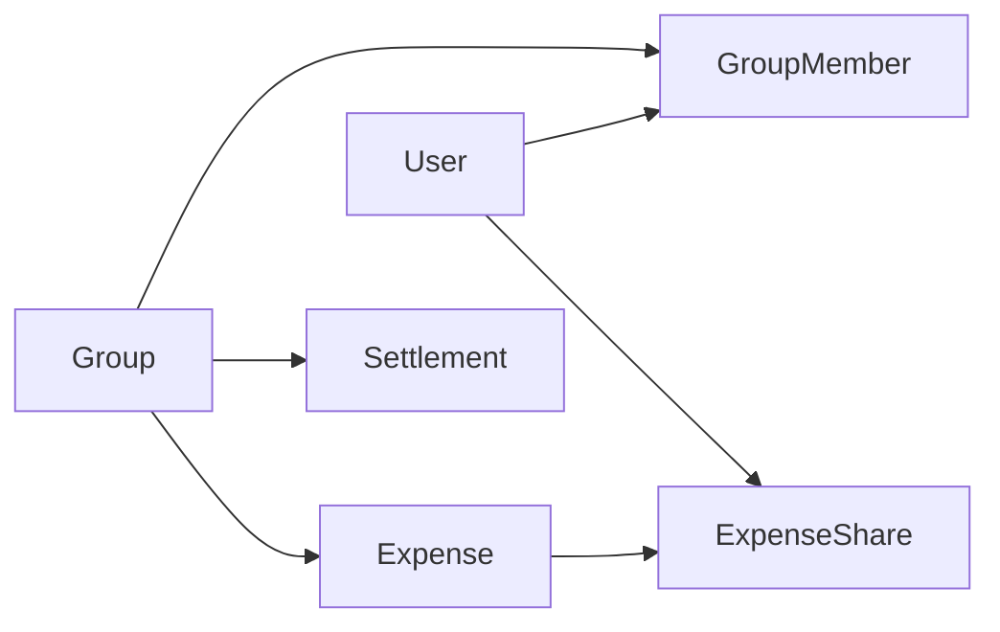

# ТЗ: сервис учёта общих расходов (учебный проект на Spring Boot)

Дата: 2026-09-16

---

## 1. О проекте

**Рабочее название:** Splitly — сервис учёта общих расходов в группе.

Компания едет в отпуск. Один оплатил дом, другой закупил продукты, третий заправлял машину. В конце поездки нужно понять, кто кому сколько должен, и закрыть долги минимальным числом переводов.

**Почему этот домен.** Это простой сценарий, в котором невозможно обойти деньги, транзакции и согласованность данных. Блог с постами прощает любые ошибки — здесь ошибка означает, что человек недосчитался денег.

### Как работать с этим ТЗ

Документ написан как заказ от бизнеса, а не как туториал. Он говорит, **что** должно работать и почему, но почти нигде не говорит, **как** это реализовать на Spring. Это ваша часть работы.

Режим работы с Клодом:

1. Берёте одну задачу из дорожной карты (раздел 9).
2. Спрашиваете: «какие концепции Spring нужны для этой задачи и почему именно они» — получаете теорию без кода.
3. Пишете код сами.
4. Присылаете на ревью: «вот что получилось, разбери ошибки и объясни, что я не учёл».
5. Отмечаете пройденное в чек-листе (раздел 11).

Главное правило: не просите готовый код целиком. Просите объяснение, ревью и подсказку при застревании.

### Определение готовности

- Сервис поднимается одной командой на чистой машине.
- Все сценарии из раздела 2 работают через HTTP.
- Подключён мобильный клиент хотя бы на два экрана.
- Интеграционные тесты проходят на настоящей базе в Testcontainers.

---

## 2. Функциональные требования

MVP закрывает один полный цикл: создать группу, позвать людей, вносить траты, увидеть балансы, погасить долги.

### Сценарии

| № | Сценарий | Итог |
| --- | --- | --- |
| 1 | Регистрация и вход по email и паролю | Клиент получает пару токенов |
| 2 | Создание группы с названием и базовой валютой | Создатель автоматически становится участником |
| 3 | Приглашение по коду | Человек вступает в группу по короткому коду |
| 4 | Внесение траты с делением поровну | Трата и доли сохранены атомарно |
| 5 | Внесение траты с делением по долям или точным суммам | Сумма долей равна сумме траты |
| 6 | Просмотр ленты трат с пагинацией | Страница трат, новые сверху |
| 7 | Редактирование и удаление своей траты | Балансы пересчитаны |
| 8 | Просмотр балансов группы | Сальдо каждого участника |
| 9 | Просмотр плана взаиморасчётов | Минимальный список переводов |
| 10 | Регистрация возврата денег | Сальдо обоих участников изменилось |
| 11 | Выход из группы | Запрещён при ненулевом сальдо |

### Границы скоупа

**В скоупе:** одна валюта на группу, произвольное число участников, три стратегии деления, мягкое удаление трат, история изменений траты.

**Вне скоупа:** мультивалютность с курсами, повторяющиеся траты, реальные платежи и эквайринг, загрузка чеков, комментарии к тратам, веб-интерфейс.

**Отложено до итерации 7:** асинхронные уведомления и всё, что требует брокера сообщений.

Вне скоупа означает «не делать», а не «сделать потом». Учебный проект убивает не сложность, а расползание требований.

---

## 3. Доменная модель

Шесть сущностей. Центральная — `Expense` вместе со своими долями: она единственная, у которой есть настоящие инварианты.



| Сущность | Ключевые поля | Смысл |
| --- | --- | --- |
| User | email, passwordHash, displayName | Учётная запись |
| Group | name, currency, createdBy, inviteCode | Поездка или общий быт |
| GroupMember | groupId, userId, role, joinedAt | Членство, роль owner или member |
| Expense | groupId, payerId, amount, description, spentAt, splitType, version, deletedAt | Кто и за что заплатил |
| ExpenseShare | expenseId, userId, amount | Доля одного участника в трате |
| Settlement | groupId, fromUserId, toUserId, amount, settledAt | Факт возврата денег |

### Инварианты

Это правила, которые не должны нарушаться никогда — ни при каком порядке запросов, ни при какой гонке.

1. Сумма всех `ExpenseShare` одной траты строго равна `Expense.amount`.
2. `Expense.amount` строго больше нуля.
3. Плательщик и все участники долей состоят в группе на момент создания траты.
4. В `Settlement` отправитель и получатель — разные люди, оба в группе.
5. Сумма сальдо всех участников группы равна нулю.
6. Пара (groupId, userId) в `GroupMember` уникальна.
7. Участник с ненулевым сальдо не может выйти из группы.

Инвариант 5 — лучший тест всей системы. Если он нарушился, где-то потерялись деньги.

### Заметки по проектированию

`Balance` сущностью не является: это результат вычисления по тратам и переводам. Не заводите под него таблицу, пока не упрётесь в производительность — денормализация без доказанной необходимости порождает рассинхрон.

Удаление траты — мягкое (`deletedAt`). Финансовая история не удаляется физически.

---

## 4. Схема базы данных

PostgreSQL. Схема пишется руками в SQL-миграциях Flyway, а не генерируется из сущностей. `ddl-auto` всегда `validate` — Hibernate проверяет соответствие, но ничего не создаёт.

### Правила

- Первичные ключи — UUID. Клиент может генерировать id сам, что удобно для идемпотентности и офлайн-режима.
- Деньги — `NUMERIC(19,4)`. Никогда `float` или `double precision`.
- Валюта — `CHAR(3)` по ISO 4217.
- Все временные метки — `TIMESTAMPTZ`, всё хранится в UTC.
- Внешние ключи объявлены явно, с осознанным `ON DELETE`.

### Таблицы

| Таблица | Столбцы сверх id | Ограничения и индексы |
| --- | --- | --- |
| users | email, password_hash, display_name, created_at | UNIQUE(email) |
| groups | name, currency, created_by, invite_code, created_at | UNIQUE(invite_code) |
| group_members | group_id, user_id, role, joined_at | UNIQUE(group_id, user_id), индекс по user_id |
| expenses | group_id, payer_id, amount, currency, description, spent_at, split_type, version, created_at, updated_at, deleted_at | CHECK(amount > 0), индекс (group_id, spent_at DESC) |
| expense_shares | expense_id, user_id, amount | UNIQUE(expense_id, user_id), CHECK(amount >= 0), ON DELETE CASCADE |
| settlements | group_id, from_user_id, to_user_id, amount, settled_at | CHECK(from_user_id <> to_user_id), CHECK(amount > 0) |
| idempotency_keys | key, user_id, endpoint, request_hash, response_body, status_code, created_at | UNIQUE(key, user_id) |

### Миграции

Порядок файлов в `db/migration`:

- `V1__users_and_auth.sql`
- `V2__groups_and_members.sql`
- `V3__expenses_and_shares.sql`
- `V4__settlements.sql`
- `V5__idempotency_keys.sql`

Правило, которое стоит усвоить сразу: применённая миграция неизменяема. Ошиблись — пишете новую, исправляющую. Правка старого файла ломает контрольную сумму Flyway и падает при старте.

### Вопросы, на которые стоит ответить самому

- Почему `UNIQUE(group_id, user_id)` — это ограничение уровня базы, а не проверка в коде?
- Что произойдёт с долями при физическом удалении траты и почему выбран `CASCADE`?
- Зачем индекс по `(group_id, spent_at DESC)` именно в таком порядке столбцов?

---

## 5. Контракт API

Базовый путь `/api/v1`. Формат обмена — JSON, даты в ISO 8601 с таймзоной, деньги — строкой (`"1234.50"`), чтобы не потерять точность в JavaScript-клиентах.

### Эндпоинты

| Метод и путь | Назначение | Успех |
| --- | --- | --- |
| POST /auth/register | Регистрация | 201 |
| POST /auth/login | Вход, выдача токенов | 200 |
| POST /auth/refresh | Обновление access-токена | 200 |
| GET /users/me | Текущий пользователь | 200 |
| POST /groups | Создать группу | 201 |
| GET /groups | Мои группы | 200 |
| GET /groups/{id} | Группа с участниками | 200 |
| POST /groups/{id}/members | Пригласить или добавить | 201 |
| POST /groups/join | Вступить по коду | 200 |
| DELETE /groups/{id}/members/me | Выйти из группы | 204 |
| POST /groups/{id}/expenses | Создать трату | 201 |
| GET /groups/{id}/expenses | Лента трат, пагинация | 200 |
| GET /expenses/{id} | Трата с долями | 200 |
| PUT /expenses/{id} | Изменить трату | 200 |
| DELETE /expenses/{id} | Удалить трату | 204 |
| GET /groups/{id}/balances | Сальдо участников | 200 |
| GET /groups/{id}/settlement-plan | План взаиморасчётов | 200 |
| POST /groups/{id}/settlements | Зафиксировать возврат | 201 |

### Создание траты

Запрос:

```
POST /api/v1/groups/{groupId}/expenses
Idempotency-Key: 6f1c2f7a-9f3e-4a11-bb62-0f0a1d2e3c44

{
  "description": "Продукты на два дня",
  "amount": "4500.00",
  "payerId": "a1b2...",
  "spentAt": "2026-07-14T18:30:00Z",
  "splitType": "EQUAL",
  "participantIds": ["a1b2...", "c3d4...", "e5f6..."]
}
```

Для `SHARES` вместо `participantIds` приходит массив `{userId, shares}`, для `EXACT` — массив `{userId, amount}`.

Ответ содержит трату вместе с рассчитанными долями — клиенту не нужен второй запрос, чтобы показать результат.

### Формат ошибки

Единый для всего API, основан на RFC 7807:

```json
{
  "type": "https://splitly.dev/errors/validation",
  "title": "Некорректный запрос",
  "status": 400,
  "detail": "Сумма долей не совпадает с суммой траты",
  "instance": "/api/v1/groups/7a.../expenses",
  "traceId": "0af7651916cd43dd",
  "errors": [{ "field": "shares", "message": "сумма 4499.99 вместо 4500.00" }]
}
```

### Коды ответов

| Код | Когда |
| --- | --- |
| 400 | Тело не прошло валидацию |
| 401 | Токена нет или он истёк |
| 403 | Пользователь не состоит в группе или не автор траты |
| 404 | Объекта нет либо он не виден этому пользователю |
| 409 | Конфликт: повторное вступление, гонка версий, выход с долгом |
| 422 | Тело валидно, но нарушает бизнес-правило |
| 500 | Всё непредвиденное, без деталей наружу |

Важное правило безопасности: если пользователь не состоит в группе, отдавайте 404, а не 403. Иначе по кодам ответов можно перебором узнать, какие группы существуют.

### Пагинация

Лента трат — курсорная, не по номеру страницы. Параметры `?limit=20&cursor=<opaque>`, ответ содержит `items` и `nextCursor`. Постраничная пагинация по `offset` ломается, когда во время листания добавляются новые записи: клиент видит дубли.

---

## 6. Бизнес-правила

Это самый содержательный раздел. Здесь живёт вся логика, ради которой затевался проект.

### Деньги

Только `BigDecimal`, всегда со `scale = 2` и `RoundingMode.HALF_UP`. Никаких `double`, `float` и умножения на 100 с переходом на `long`.

Запрещено сравнивать суммы через `equals`: `new BigDecimal("10.0").equals(new BigDecimal("10.00"))` возвращает `false`, потому что `equals` учитывает scale. Сравнение — только `compareTo`.

### Деление поровну и проблема остатка

4500 ₽ на троих делится ровно. 100 ₽ на троих — нет: получается 33.33 + 33.33 + 33.33 = 99.99, и одна копейка теряется.

Правило: считаем базовую долю округлением вниз, затем распределяем остаток по одной минимальной единице, начиная с первого участника в детерминированном порядке — например, по возрастанию userId. Детерминированность важна: пересчёт той же траты обязан давать тот же результат.

```
base = floor(amount / n)
remainder = amount - base * n   // в копейках
первые remainder участников получают base + 0.01
```

Проверка после расчёта: сумма долей равна сумме траты. Если нет — исключение, транзакция откатывается.

### Стратегии деления

| Тип | Вход | Правило |
| --- | --- | --- |
| EQUAL | список участников | поровну, остаток по алгоритму выше |
| SHARES | участник и его вес | пропорционально весам, остаток так же |
| EXACT | участник и его сумма | суммы приходят готовыми, проверяется равенство итогу |

Для `EXACT` сервер ничего не считает, только валидирует. Для остальных — считает сам и никогда не доверяет присланным клиентом суммам.

### Расчёт балансов

Сальдо участника в группе:

```
balance(u) = Σ(суммы трат, где u плательщик)
           − Σ(доли u во всех тратах)
           + Σ(переводы, отправленные u)
           − Σ(переводы, полученные u)
```

Положительное сальдо — человеку должны, отрицательное — должен он. Сумма сальдо всех участников всегда равна нулю; это ассерт, который стоит проверять в тестах.

Удалённые траты (`deletedAt IS NOT NULL`) в расчёт не входят.

### План взаиморасчётов

Задача: закрыть все долги минимальным числом переводов. Жадный алгоритм:

1. Разделить участников на должников (сальдо < 0) и кредиторов (сальдо > 0).
2. Взять крупнейшего должника и крупнейшего кредитора.
3. Перевести между ними минимум из двух модулей.
4. Убрать обнулившегося, повторять, пока остаются пары.

Для N участников результат — не более N−1 переводов. Строго оптимальное решение — NP-трудная задача, но жадный вариант на группах из 5–15 человек даёт результат, неотличимый от оптимального.

План не сохраняется в базу: это подсказка, вычисляемая на лету. Фиксируется только `Settlement` — факт реального возврата денег.

### Правила изменения данных

- Редактировать и удалять трату может её автор или владелец группы.
- При изменении суммы или состава участников доли пересчитываются целиком, в одной транзакции.
- Перевод нельзя отредактировать — только удалить и создать заново.
- Выход из группы при ненулевом сальдо запрещён, ответ 409.

---

## 7. Нефункциональные требования

### Аутентификация

JWT: короткоживущий access-токен (15 минут) и долгий refresh-токен (30 дней) в базе, с возможностью отзыва. Пароли — BCrypt с cost 12. Секрет подписи — из переменных окружения, никогда в репозитории.

Мобильному клиенту нужен именно refresh: пользователь не станет вводить пароль каждые 15 минут.

### Авторизация

Двухуровневая проверка на каждом запросе к ресурсам группы:

1. Пользователь аутентифицирован.
2. Пользователь состоит в этой группе.

Второй шаг — не формальность. Самая частая уязвимость учебных проектов: `GET /expenses/{id}` возвращает чужую трату, потому что проверили только токен. Любой запрос по id обязан проверять принадлежность объекта к группе, где состоит вызывающий.

### Идемпотентность

Обязательна для `POST /expenses` и `POST /settlements` — операций с деньгами.

Механика: клиент присылает `Idempotency-Key`. Сервер ищет ключ в таблице. Если ключа нет — выполняет операцию и сохраняет ответ. Если ключ есть и хэш тела совпадает — возвращает сохранённый ответ, не выполняя операцию повторно. Если ключ есть, а тело другое — 409.

Сценарий, ради которого всё это: клиент отправил трату, соединение оборвалось до получения ответа, пользователь нажал «повторить». Без идемпотентности в группе появляется вторая трата на ту же сумму.

### Конкурентность

Оптимистичные блокировки на `Expense` через поле `version`. При редактировании клиент присылает версию, которую видел; если она устарела — 409 с актуальным состоянием, клиент показывает конфликт.

Сценарий для теста: два запроса одновременно правят одну трату, третий в этот момент читает балансы. Ни при каком порядке инвариант «сумма сальдо равна нулю» не должен нарушиться.

### Наблюдаемость

- Логи в JSON, каждый запрос помечен `traceId`, который же уходит клиенту в ответе об ошибке.
- В логи никогда не попадают пароли, токены и заголовки авторизации.
- Spring Boot Actuator: `/health`, `/info`, `/metrics`.
- В dev-профиле включён `show-sql` с форматированием — без этого вы не увидите проблему N+1.

### Производительность

Целевой ориентир на локальной машине: группа из 10 участников и 500 трат, `GET /balances` укладывается в 200 мс. Это достижимо только если расчёт идёт агрегатом в SQL, а не выгрузкой всех сущностей в память.

Лента трат обязана отдаваться без N+1: проверяется подсчётом запросов Hibernate в интеграционном тесте.

---

## 8. Стек и структура

### Технологии

| Что | Выбор | Почему |
| --- | --- | --- |
| Язык | Java LTS, актуальная версия | records и sealed сильно упрощают DTO |
| Фреймворк | Spring Boot, текущая стабильная ветка | стартеры закрывают всю обвязку |
| Сборка | Gradle или Maven | вкус; Gradle ближе Android-разработчику |
| БД | PostgreSQL в Docker | не H2: нужны настоящие типы и транзакции |
| Доступ к данным | Spring Data JPA + native SQL для агрегатов | балансы считаются запросом, не в памяти |
| Миграции | Flyway | версионирование схемы |
| Безопасность | Spring Security + jjwt | |
| Документация | springdoc-openapi | Swagger UI для ручной проверки |
| Тесты | JUnit 5, MockMvc, Testcontainers, AssertJ | |

Конкретные версии уточните при старте: ветки Spring Boot и LTS-версии Java двигаются, и совместимость между ними жёсткая.

### Структура пакетов

Группировка по функциям, а не по слоям. `controller/`, `service/`, `repository/` на верхнем уровне — антипаттерн: чтобы понять одну фичу, приходится прыгать по всему дереву.

```
com.splitly
├── common/          общие DTO ошибок, обработчик исключений, утилиты денег
├── config/          SecurityConfig, OpenApiConfig, JacksonConfig
├── auth/            контроллер, сервис, JWT-фильтр, токены
├── user/
├── group/           группы, участники, приглашения
├── expense/         траты, доли, стратегии деления
├── balance/         расчёт сальдо и план взаиморасчётов
├── settlement/
└── idempotency/     фильтр или интерцептор + хранилище ключей
```

Внутри каждого пакета: `XxxController`, `XxxService`, `XxxRepository`, `dto/`, `entity/`, `mapper/`.

### Слои и правила

- Контроллер: разбор HTTP, валидация, вызов сервиса. Никакой бизнес-логики.
- Сервис: бизнес-логика и границы транзакций. `@Transactional` живёт здесь, не в контроллере и не в репозитории.
- Репозиторий: только доступ к данным.
- Сущности JPA не покидают сервисный слой. Наружу уходят DTO.

### Локальный запуск

`docker-compose.yml` поднимает PostgreSQL и pgAdmin. Приложение запускается из IDE или `./gradlew bootRun` с профилем `dev`. Секреты — через `.env`, который лежит в `.gitignore`.

Критерий готовности первой итерации: человек, впервые склонировавший репозиторий, запускает всё двумя командами и видит зелёный `/health`.

---

## 9. Дорожная карта

Шесть основных итераций плюс две необязательные. Каждая заканчивается работающим состоянием, которое можно потрогать через HTTP. Ориентировочные сроки даны для вечерних занятий после работы.

Итерации 1–6 — это законченный продукт. Итерация 7 добавляет асинхронную обработку и берётся только после них. Итерация 8 — уже отдельный проект, который использует Splitly как полигон.

### Итерация 1. Скелет (3–5 вечеров)

- [ ] Проект со start.spring.io, зависимости: web, jpa, postgresql, flyway, validation
- [ ] docker-compose с PostgreSQL
- [ ] Подключение к базе, первая миграция, `ddl-auto: validate`
- [ ] Actuator, эндпоинт `/api/v1/version`
- [ ] README с командами запуска

**Приёмка:** `docker compose up`, затем `bootRun` — и `/health` отвечает.

**Чему учит:** автоконфигурация Spring Boot, профили, `application.yml`, жизненный цикл миграций.

### Итерация 2. Группы и участники (5–7 вечеров)

- [ ] Сущности User, Group, GroupMember
- [ ] CRUD групп, DTO отдельно от сущностей
- [ ] Валидация через `@Valid`, глобальный `@RestControllerAdvice`
- [ ] Присоединение по invite-коду
- [ ] Swagger UI

**Приёмка:** через Swagger создаётся группа, добавляются участники, ошибки приходят в едином формате.

**Чему учит:** DI и бины, слои, маппинг, обработка исключений. Это итерация, где щёлкает идея контейнера.

### Итерация 3. Траты и деление (7–10 вечеров)

- [ ] Expense и ExpenseShare
- [ ] Три стратегии деления отдельными классами
- [ ] Алгоритм остатка от округления
- [ ] Проверка инвариантов внутри транзакции
- [ ] Лента трат с курсорной пагинацией
- [ ] Редактирование и мягкое удаление

**Приёмка:** трата на 100 ₽ между тремя участниками даёт доли 33.34, 33.33, 33.33, и их сумма ровно 100.00.

**Чему учит:** `@Transactional` и его границы, `BigDecimal`, паттерн стратегии, N+1 и `JOIN FETCH`. Самая насыщенная итерация.

### Итерация 4. Балансы и взаиморасчёты (4–6 вечеров)

- [ ] Расчёт сальдо агрегирующим SQL-запросом
- [ ] Жадный алгоритм минимизации переводов
- [ ] Settlement
- [ ] Запрет выхода из группы с долгом

**Приёмка:** после выполнения всех переводов из плана все сальдо равны нулю.

**Чему учит:** нативные запросы и проекции, разница между вычисляемым и хранимым, алгоритмика в сервисном слое.

### Итерация 5. Безопасность (7–10 вечеров)

- [ ] Регистрация, BCrypt
- [ ] JWT: access и refresh, фильтр, `SecurityFilterChain`
- [ ] Проверка членства в группе на каждом запросе
- [ ] 404 вместо 403 для чужих ресурсов
- [ ] Тесты на попытки доступа к чужим данным

**Приёмка:** без токена всё закрыто; с токеном чужой группы — 404.

**Чему учит:** Spring Security. Самая недружелюбная часть экосистемы, поэтому она и стоит пятой, а не первой.

### Итерация 6. Продакшен-качества (5–7 вечеров)

- [ ] Идемпотентность операций с деньгами
- [ ] Оптимистичные блокировки и обработка 409
- [ ] Testcontainers на интеграционных тестах
- [ ] JSON-логи с traceId
- [ ] Dockerfile, сборка образа

**Приёмка:** повторный запрос с тем же `Idempotency-Key` не создаёт вторую трату.

**Чему учит:** различие между «работает у меня» и «работает в проде».

### Итерация 7. Асинхронная обработка (7–10 вечеров, опционально)

Берётся только после того, как первые шесть итераций закрыты. Брокер в проекте, где он не нужен, — перепроектирование; здесь он нужен ровно в одном месте.

**Задача из предметной области.** Участник добавил трату — остальным членам группы надо сообщить. Отправлять уведомление синхронно внутри транзакции нельзя: внешний сервис тормозит или падает, и вместе с ним падает сохранение траты.

Шаги:

- [ ] Доменное событие `ExpenseCreated`, публикуемое через `@TransactionalEventListener(phase = AFTER_COMMIT)` — пока без всякого брокера, только внутри приложения
- [ ] Kafka в docker-compose, продюсер в сервисе трат, отдельный консьюмер уведомлений
- [ ] Обработка повторной доставки: консьюмер идемпотентен, обработанные offset-ы или ключи событий фиксируются
- [ ] Dead letter queue для сообщений, падающих всегда
- [ ] Паттерн transactional outbox: событие пишется в таблицу в той же транзакции, что и трата, отдельный воркер вычитывает её и публикует в брокер

**Приёмка:** при остановленной Kafka трата сохраняется нормально, а уведомление уходит после её поднятия. Двойная доставка одного события не порождает двух уведомлений.

**Чему учит:** это единственная итерация про распределённые системы. Дуальная запись в базу и брокер без outbox всегда рассогласуется — вы увидите это на своём коде, а не прочитаете в статье. Плюс разница между at-least-once и exactly-once перестаёт быть словами.

**Вопросы для самопроверки:**

- Почему событие нельзя публиковать внутри транзакции, до коммита?
- Почему `AFTER_COMMIT` решает эту проблему лишь частично и что остаётся сломанным?
- Что именно гарантирует outbox и какой ценой?
- Почему exactly-once в общем случае недостижим и что делают вместо него?

### Итерация 8. Собственный брокер (отдельный проект)

Продолжение вашей второй идеи, но уже с полигоном для испытаний: сервис из итераций 1–7 становится реальным потребителем.

Ограниченный скоуп, иначе проект не заканчивается никогда:

- [ ] Топики с партициями, append-only лог на диске, сегменты по размеру
- [ ] Офсеты консьюмеров хранятся на стороне брокера
- [ ] At-least-once честно, без попыток в exactly-once
- [ ] Бинарный протокол поверх TCP и свой клиент
- [ ] Один узел, без репликации и кластера

Репликация, выбор лидера и Raft — сознательно вне скоупа. Это отдельный проект на полгода, и именно на нём такие затеи обычно умирают.

**Приёмка:** Splitly работает на вашем брокере вместо Kafka; после убийства процесса брокера и перезапуска ни одно подтверждённое сообщение не потеряно.

**Чему учит:** это уже не Spring, а системное программирование на JVM — работа с `FileChannel` и `ByteBuffer`, `fsync` и его цена, пулы потоков, обратное давление при медленном консьюмере. Kafka перестаёт быть чёрным ящиком.

### После: мобильный клиент

Два экрана — список групп и добавление траты. Именно здесь вы поймёте, насколько удобен спроектированный вами API. Если для отрисовки одного экрана нужно три запроса — это ваш дизайн, и его стоит переделать.

---

## 10. Тестирование

Цель — не процент покрытия, а уверенность в деньгах. Пишите тесты на то, где ошибка стоит дорого.

### Уровни

| Уровень | Чем | Что покрывает |
| --- | --- | --- |
| Модульные | JUnit 5 + AssertJ | стратегии деления, остаток, алгоритм взаиморасчётов |
| Слой веба | MockMvc со `@WebMvcTest` | коды ответов, валидация, формат ошибок |
| Интеграционные | `@SpringBootTest` + Testcontainers | реальные транзакции, SQL, миграции |

H2 в тестах не используется. Поведение при конкурентности и часть SQL у неё отличаются от PostgreSQL, и тест проходит там, где прод ломается.

### Обязательные тест-кейсы

- [ ] 100 ₽ на троих: доли 33.34 + 33.33 + 33.33 = 100.00
- [ ] 0.01 ₽ на двоих: одному копейка, другому ноль
- [ ] EXACT с суммой долей, не равной сумме траты, — отказ 422
- [ ] Трата с нулевой или отрицательной суммой — отказ
- [ ] Трата с участником не из группы — отказ
- [ ] Сумма сальдо всех участников равна нулю на случайном наборе из 50 трат
- [ ] После применения всего плана взаиморасчётов все сальдо нулевые
- [ ] Повторный `Idempotency-Key` не создаёт вторую трату
- [ ] Два параллельных редактирования одной траты: одно проходит, второе даёт 409
- [ ] Чужая трата по прямому id — 404, а не 403
- [ ] Лента из 200 трат укладывается в фиксированное число SQL-запросов

Последний кейс — способ поймать N+1 автоматически, а не глазами в логах.

### Проверка свойств

Для денег особенно полезны property-based тесты (jqwik): сгенерировать случайную сумму и случайное число участников, поделить, проверить, что сумма долей равна исходной сумме. Одна такая проверка находит больше, чем двадцать примеров, придуманных руками.

---

## 11. Учебный трек

### Чек-лист концепций

Отмечайте пункт, когда можете объяснить его вслух своими словами, не подглядывая.

- [ ] Что делает Spring-контейнер и почему объекты создаёт не мой код
- [ ] Чем `@Component`, `@Service`, `@Repository` отличаются на практике
- [ ] Как работает автоконфигурация Boot и как посмотреть, что она включила
- [ ] Где начинается и где заканчивается транзакция при `@Transactional`
- [ ] Почему `@Transactional` не работает на приватном методе и при вызове изнутри того же класса
- [ ] Что такое persistence context и когда сущность становится detached
- [ ] Почему `LAZY` бросает исключение вне транзакции
- [ ] Как возникает N+1 и три способа его убрать
- [ ] Почему `equals` у `BigDecimal` — ловушка
- [ ] Чем оптимистичная блокировка отличается от пессимистичной и когда нужна каждая
- [ ] Как запрос проходит цепочку фильтров Spring Security
- [ ] Чем аутентификация отличается от авторизации в коде, а не в теории
- [ ] Почему access-токен короткий, а refresh — длинный
- [ ] Что именно делает идемпотентность и почему она нужна мобильному клиенту
- [ ] Чем DTO отличается от entity и почему их нельзя объединять

Для итерации 7:

- [ ] Почему запись в базу и отправку в брокер нельзя считать одной операцией
- [ ] Что решает transactional outbox и какой ценой
- [ ] Чем at-least-once отличается от at-most-once и почему exactly-once почти всегда иллюзия
- [ ] Что такое обратное давление и что происходит, когда консьюмер медленнее продюсера

### Как формулировать вопросы

Работает:

- «Объясни, как Spring понимает, куда подставить этот бин»
- «Вот мой сервис, где я неправильно расставил границы транзакции»
- «Почему здесь вылетает LazyInitializationException, объясни механику»
- «Дай три варианта решения с плюсами и минусами, выбор оставь мне»
- «Задай мне пять вопросов по транзакциям и проверь мои ответы»

Не работает:

- «Напиши сервис для трат» — код появится, понимание нет
- «Почему не работает» без кода и текста ошибки

### Типичные ошибки на этом проекте

| Ошибка | Чем оборачивается |
| --- | --- |
| `double` для денег | копейки расходятся, инвариант ломается |
| Entity наружу в JSON | утечка полей, циклы сериализации, связанность API со схемой |
| `@Transactional` на контроллере | транзакция держится всё время сериализации ответа |
| `ddl-auto: update` | схема расходится с миграциями, на проде сюрприз |
| Проверка только токена без проверки членства | чужие данные доступны по прямому id |
| Доли, посчитанные на клиенте | клиент подделывает суммы |
| Логика в репозитории | бизнес-правила размазаны, тестировать нечего |
| H2 в тестах вместо Testcontainers | зелёные тесты при сломанном проде |

### Ритм

По одной задаче из чек-листа за подход. После каждой итерации — коммит с осмысленным сообщением и короткая запись в README о том, что нового вы поняли. Через три месяца эта запись будет вашим лучшим доказательством роста на собеседовании.
